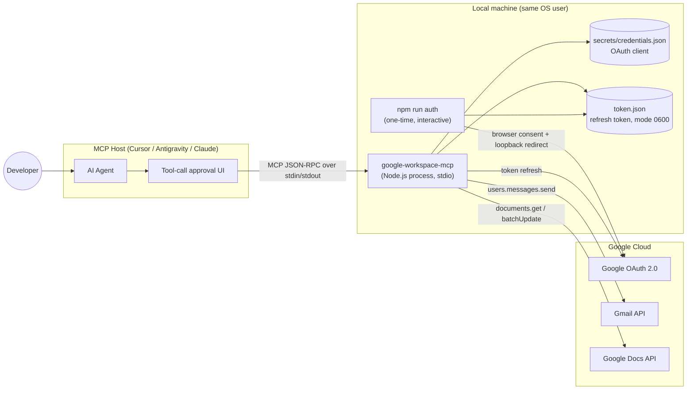
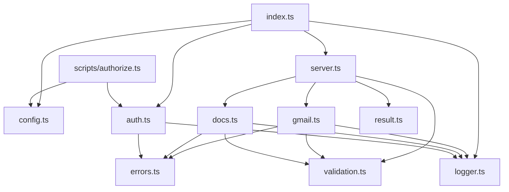
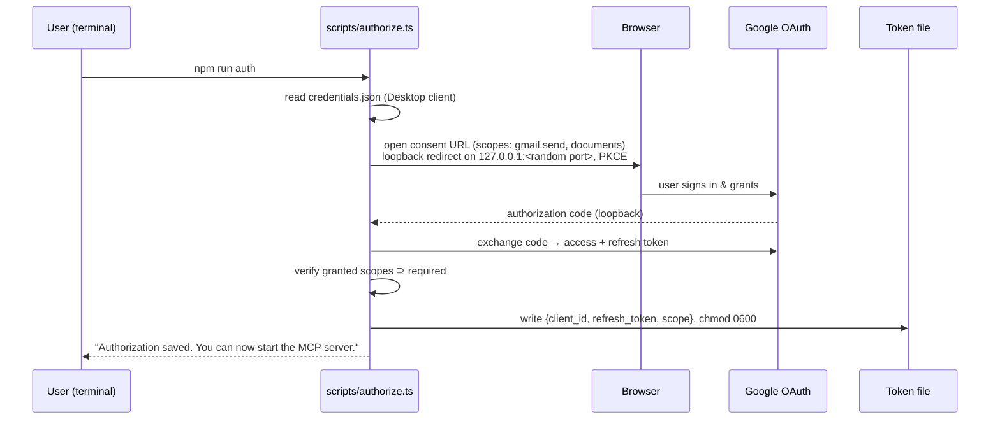
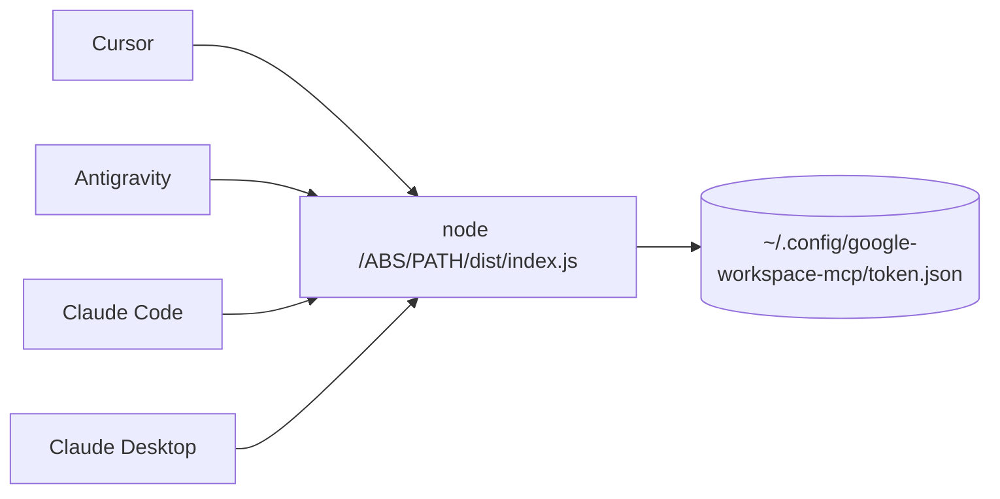

# Architecture: `google-workspace-mcp`

**Status:** Design document for the MVP described in [`problemStatement.md`](./problemStatement.md)
**Scope:** Local, single-user, `stdio` MCP server exposing exactly two write tools — `send_email` and `append_to_google_doc`.

---

## 1. Goals and Non-Goals

### Goals

- One local Node.js/TypeScript process that any MCP host (Cursor, Antigravity, Claude Code, Claude Desktop) can launch with `node /ABSOLUTE/PATH/google-workspace-mcp/dist/index.js`.
- Exactly two tools, each a thin, well-validated wrapper around one Google API write call.
- OAuth 2.0 (Desktop client) for a single OS user, with credentials stored once on the machine and shared by all local hosts.
- Predictable behavior: no false success, no silent retries of writes, no secrets in logs, nothing but MCP JSON-RPC on stdout.

### Non-Goals (MVP)

- Reading Gmail, searching Drive, creating Docs, HTML/attachments/CC/BCC, rich formatting.
- HTTP transport, multi-user, hosting, databases, or UI.
- Service accounts / domain-wide delegation.

---

## 2. System Context



**Trust boundaries**

| Boundary | Trusted side | Untrusted side | Control |
| --- | --- | --- | --- |
| Host → Server | Server code | Tool arguments (produced by an LLM, possibly influenced by prompt injection) | Host-side approval + server-side Zod validation |
| Server → Google | Server | Network | TLS via `googleapis`, minimal scopes |
| Server ↔ Disk | Server | Other users/processes on machine | Files outside repo, `0600` token file, `.gitignore` |

---

## 3. Process Model

There are **two separate entry points** that share the same auth module:

| Entry point | Command | Interactive? | Purpose |
| --- | --- | --- | --- |
| `scripts/authorize.ts` | `npm run auth` | Yes (opens browser) | One-time OAuth consent; writes the token file. |
| `src/index.ts` | `npm start` / `node dist/index.js` | No | Long-running MCP server launched by the host over `stdio`. |

The MCP server **never** starts a browser flow. If no valid token exists, tools fail with `AUTH_REQUIRED` and instruct the user to run `npm run auth`. This keeps the server non-interactive (hosts spawn it headlessly) and keeps stdout clean.

---

## 4. Module Design

```text
google-workspace-mcp/
├── src/
│   ├── index.ts          # Composition root: config → auth → Google clients → serveStdio
│   ├── server.ts         # createServer(services): McpServer + tool registration
│   ├── config.ts         # Reads/validates env (paths), resolves absolute paths
│   ├── auth.ts           # Load token, build OAuth2Client, persist refreshed tokens
│   ├── gmail.ts          # sendEmail(): MIME build → base64url → users.messages.send
│   ├── docs.ts           # appendToDoc(): get end state → batchUpdate insertText
│   ├── validation.ts     # Zod schemas, email/header checks, Doc ID extraction
│   ├── errors.ts         # ToolError type, Google error → ToolError mapping
│   ├── result.ts         # Helpers to shape MCP tool results (success/failure)
│   └── logger.ts         # stderr-only logger with redaction
├── scripts/
│   └── authorize.ts      # Interactive OAuth bootstrap
├── tests/
│   ├── gmail.test.ts
│   ├── docs.test.ts
│   ├── validation.test.ts
│   ├── auth.test.ts
│   ├── logger.test.ts
│   └── stdio.test.ts     # Spawns the server, asserts stdout is JSON-RPC only
├── examples/             # Host config samples (Cursor, Antigravity, Claude Code, Claude Desktop)
├── .env.example
├── .gitignore
├── package.json
├── tsconfig.json
└── README.md
```

### Dependency graph



Rules:

- `gmail.ts` and `docs.ts` receive their Google client **as a parameter** (dependency injection). They never construct clients or read files. This is what makes them unit-testable with mocks.
- Only `server.ts` and `index.ts` know about MCP. Business modules return plain typed results or throw `ToolError`; `server.ts` converts those into MCP tool responses. `index.ts` wires real Google clients into `createServer()`.
- Only `logger.ts` writes output, and only to **stderr**.

### Module responsibilities

| Module | Key exports | Responsibilities |
| --- | --- | --- |
| `config.ts` | `loadDotEnv()`, `loadConfig(): Config` | Read `GOOGLE_OAUTH_CREDENTIALS_PATH`, `GOOGLE_OAUTH_TOKEN_PATH` (env, then `<project>/.env`); apply defaults (`<project>/secrets/credentials.json`, `~/.config/google-workspace-mcp/token.json`); resolve relative paths against the project root; never read secrets themselves. |
| `auth.ts` | `AuthManager.getAuthorizedClient()`, `saveToken()`, `readClientCredentials()` | Load client JSON + token, build `OAuth2Client`, refresh the access token up front, subscribe to `tokens` event to persist rotated refresh tokens with `0600`, verify granted scopes. |
| `server.ts` | `createServer(services)` | Register both tools on `McpServer`, run strict validation, map `ToolError` → MCP result. |
| `validation.ts` | `SendEmailInput`, `AppendDocInput`, `extractDocumentId()` | Zod schemas, length limits, CR/LF rejection, URL → ID extraction. |
| `gmail.ts` | `sendEmail(gmail, input)` | Build UTF-8 MIME via a vetted library, base64url encode, call `users.messages.send` once. |
| `docs.ts` | `appendToDoc(docs, input)` | Read document end state, compute separator, one `batchUpdate` with `insertText`. |
| `errors.ts` | `ToolError`, `mapGoogleError(err, op)` | Stable error codes, actionable messages, ambiguity detection. |
| `result.ts` | `ok(data)`, `fail(err)` | Produce MCP `CallToolResult` with text + `structuredContent`, `isError` on failure. |
| `logger.ts` | `log.info/warn/error` | stderr only; redacts tokens, auth codes, email bodies, doc content. |

---

## 5. MCP Layer

The server uses the **MCP TypeScript SDK v2** (`@modelcontextprotocol/server` 2.4): `McpServer` + `registerTool()` from `@modelcontextprotocol/server`, and `serveStdio(factory)` from `@modelcontextprotocol/server/stdio`. The v1 `@modelcontextprotocol/sdk` package is not used.

Tools advertise a simple Zod schema (field types + descriptions) to the host; the strict schemas in `validation.ts` run inside the handler so every rejection has the same `VALIDATION_ERROR` shape.

### Startup sequence

```mermaid
sequenceDiagram
    participant Host as MCP Host
    participant Idx as index.ts
    participant Cfg as config.ts
    participant Auth as auth.ts
    participant SDK as McpServer (v2)

    Host->>Idx: spawn `node dist/index.js` (stdin/stdout pipes)
    Idx->>Cfg: loadConfig()
    Idx->>Auth: new AuthManager(cfg) (token loaded lazily on first tool call)
    Note over Auth: Missing token does NOT crash startup;<br/>tools return AUTH_REQUIRED instead
    Idx->>SDK: serveStdio(() => createServer(services))
    SDK->>SDK: new McpServer({ name, version }), register both tools
    Host->>SDK: initialize / tools/list
    SDK-->>Host: 2 tools + input schemas
```

Starting successfully even without a token is deliberate: the host can still list tools, and the user gets an actionable error on first call instead of an opaque "server failed to start".

### Tool registration contract

| Tool | Input (Zod) | Annotations (hints to host) |
| --- | --- | --- |
| `send_email` | `{ to: email, subject: string, body: string }` | `readOnlyHint: false`, `destructiveHint: false`, `idempotentHint: false`, `openWorldHint: true` |
| `append_to_google_doc` | `{ documentId: string, content: string }` | `readOnlyHint: false`, `destructiveHint: false`, `idempotentHint: false`, `openWorldHint: true` |

Tool descriptions explicitly tell the agent: *"This performs a real write. Show the user the exact arguments and obtain confirmation before calling."* Annotations are hints only — **confirmation is enforced by the host**, and the README instructs users not to enable auto-approve for these tools.

### Result shape

Every call returns both human-readable text and machine-readable structured content:

```ts
// success
{ content: [{ type: "text", text: "Email sent successfully (messageId …)" }],
  structuredContent: { success: true, message, messageId, threadId } }

// failure
{ isError: true,
  content: [{ type: "text", text: "GMAIL_PERMISSION_DENIED: …" }],
  structuredContent: { success: false, error: "GMAIL_PERMISSION_DENIED", message } }
```

Unexpected exceptions are caught at the tool boundary in `server.ts` and converted to `INTERNAL_ERROR` — they never crash the process or leak stack traces into tool output (stack traces go to stderr, redacted).

---

## 6. Authentication & Token Lifecycle

### Bootstrap (`npm run auth`)



Implemented as a small hand-rolled loopback flow on `google-auth-library`'s `OAuth2Client` (not `@google-cloud/local-auth`, which neither forces consent nor uses PKCE/state). `access_type: "offline"` and `prompt: "consent"` ensure a refresh token is issued. The token file stores only the refresh token, granted scopes, and client ID; access tokens are kept in memory. No `openid`/`email` scope is requested, so the CLI does not display the account email.

### Scopes

| Scope | Used by | Note |
| --- | --- | --- |
| `https://www.googleapis.com/auth/gmail.send` | `send_email` | Send-only; cannot read mail. |
| `https://www.googleapis.com/auth/documents` | `append_to_google_doc` | Broad (all Docs the user can edit). Future: `drive.file` + explicit picker. |

### Runtime

1. `AuthManager` lazily loads the token file on first tool call and caches the `OAuth2Client` (only after a successful load, so `npm run auth` takes effect without restarting the server).
2. Before every Google call, `getAuthorizedClient()` calls `getAccessToken()`, refreshing if needed. Refresh failures therefore surface as definite errors *before* a write is attempted, never as ambiguous write outcomes.
3. On the client's `tokens` event, if the refresh token rotated, atomically rewrite the token file (write temp → rename, `0600`).
4. Failure mapping:
   - OAuth client JSON missing / not a Desktop client → `CONFIG_ERROR`
   - Token file missing, corrupt, or issued for another client → `AUTH_REQUIRED`
   - Network failure during refresh → `NETWORK_ERROR`
   - `invalid_grant` (revoked/expired refresh token) → `AUTH_EXPIRED` ("run `npm run auth` again")
   - Required scope not granted → `AUTH_SCOPE_MISSING`
   - Org policy blocks the app → `AUTH_POLICY_BLOCKED` (report, do not work around)

### File locations

| File | Default | Committed? |
| --- | --- | --- |
| OAuth client JSON | `GOOGLE_OAUTH_CREDENTIALS_PATH` (e.g. `./secrets/credentials.json`) | Never (`.gitignore`) |
| Token store | `GOOGLE_OAUTH_TOKEN_PATH` (default under `~/.config/google-workspace-mcp/`) | Never; outside repo; `0600` |
| `.env` | repo root | Never; only `.env.example` is committed |

Because tokens live at a per-OS-user path, every host on the machine launching the same `dist/index.js` shares one authorization.

---

## 7. Tool Flows

### 7.1 `send_email`

```mermaid
sequenceDiagram
    participant Agent as Host / Agent
    participant Srv as index.ts
    participant Val as validation.ts
    participant Gm as gmail.ts
    participant API as Gmail API

    Agent->>Agent: show to/subject/body, user approves
    Agent->>Srv: tools/call send_email {to, subject, body}
    Srv->>Val: SendEmailInput.parse()
    alt invalid
        Val-->>Srv: VALIDATION_ERROR
        Srv-->>Agent: isError, no API call
    end
    Srv->>Gm: sendEmail(gmailClient, input)
    Gm->>Gm: build MIME (UTF-8, text/plain, From omitted → Gmail uses "me")
    Gm->>Gm: base64url(raw)
    Gm->>API: users.messages.send({userId:"me", requestBody:{raw}})
    alt 2xx
        API-->>Gm: {id, threadId}
        Gm-->>Srv: {messageId, threadId}
        Srv-->>Agent: success
    else definite failure (400/401/403/429)
        API-->>Gm: error
        Gm-->>Srv: mapped ToolError
        Srv-->>Agent: isError
    else ambiguous (timeout, network reset, 5xx)
        Gm-->>Srv: GMAIL_SEND_UNCONFIRMED
        Srv-->>Agent: "May or may not have been sent; check Sent folder. Not retried."
    end
```

Key decisions:

- **No `from` input.** The sender is always the authenticated account (`userId: "me"`).
- **MIME via a vetted library:** `nodemailer`'s `MailComposer`, never string-concatenated headers. (`mimetext` was rejected: it requires a `From` header and passed CR/LF through in recipients.) Subject is RFC 2047–encoded for non-ASCII; body is `text/plain; charset=UTF-8` with line breaks preserved.
- **Defense in depth on headers:** Zod rejects CR/LF in `to`/`subject` *before* the MIME builder runs.
- **Exactly one send call per tool invocation.** `googleapis`' built-in retry is disabled for this request (`retry: false`) and a 30 s timeout bounds it.

### 7.2 `append_to_google_doc`

```mermaid
sequenceDiagram
    participant Agent as Host / Agent
    participant Srv as index.ts
    participant Val as validation.ts
    participant Dc as docs.ts
    participant API as Docs API

    Agent->>Agent: show target doc + exact text, user approves
    Agent->>Srv: tools/call append_to_google_doc {documentId, content}
    Srv->>Val: AppendDocInput.parse() + extractDocumentId()
    alt invalid
        Val-->>Srv: VALIDATION_ERROR
        Srv-->>Agent: isError, no API call
    end
    Srv->>Dc: appendToDoc(docsClient, {id, content})
    Dc->>API: documents.get(id, fields: body end / last paragraph)
    Note over Dc,API: Read-only; safe to retry on 429/5xx.<br/>404/403 surface here before any write.
    API-->>Dc: document body (first tab)
    Dc->>Dc: compute separator (see below)
    Dc->>API: documents.batchUpdate([insertText{endOfSegmentLocation:{}, text}])
    alt 2xx
        Dc-->>Srv: {documentId, documentUrl}
        Srv-->>Agent: success (+ "appended to first tab")
    else ambiguous
        Dc-->>Srv: DOCS_APPEND_UNCONFIRMED (not retried)
    end
```

**Paragraph separation logic** (`endOfSegmentLocation` inserts *before* the body's final newline):

| Existing body | Inserted text | Result |
| --- | --- | --- |
| Empty (only the terminal `\n`) | `content` | Content becomes the first paragraph; no leading blank line. |
| Non-empty, last paragraph has text | `"\n" + content` | Content starts on a new paragraph; never merges into the last line. |
| Non-empty, last paragraph already empty | `content` | Avoids a double blank line. |

If `content` already begins with `\n`, no separator is added. User content is otherwise inserted verbatim (CRLF normalized to LF).

**Tabs:** MVP targets the **first tab** (omit `tabId` in the location; call `documents.get` without `includeTabsContent`). The success message states this. A future optional `tabId` input maps directly to `endOfSegmentLocation.tabId`.

**Document ID extraction** (`validation.ts`):

- Accept a bare ID matching `^[A-Za-z0-9_-]{20,}$`, or
- A URL with host exactly `docs.google.com` and path `/document/d/<ID>/...` (also `/document/u/<n>/d/<ID>`).
- Reject other hosts, `/spreadsheets/`, `/presentation/`, `javascript:` etc. Parse with `new URL()`, never with a loose substring search.

---

## 8. Validation Rules

| Field | Rule |
| --- | --- |
| `to` | Single address; Zod `.email()`; ≤ 254 chars; no `,` `;` `<` `>` CR, LF. |
| `subject` | Trimmed non-empty; ≤ 255 chars; no CR/LF. |
| `body` | Non-empty after trim; ≤ 100 KB; line breaks preserved (not trimmed internally). |
| `documentId` | ID or Docs URL per §7.2; extracted ID returned to caller. |
| `content` | Non-empty after trim; ≤ 100 KB; plain text; control chars other than `\n`/`\t` stripped or rejected. |

Validation failures return `VALIDATION_ERROR` with the field name and reason, and **never** touch the network.

---

## 9. Error Model

`ToolError { code, message, retryable: boolean, ambiguous: boolean }`

| Code | Trigger | User-facing guidance |
| --- | --- | --- |
| `VALIDATION_ERROR` | Zod / ID extraction failure | Fix the named field. |
| `CONFIG_ERROR` | OAuth client JSON missing, invalid, or not a Desktop client | Follow Google Cloud setup in README. |
| `AUTH_REQUIRED` | No / corrupt token file, or token for another client | Run `npm run auth`. |
| `AUTH_EXPIRED` | `invalid_grant`, 401 after refresh | Re-run `npm run auth`. |
| `AUTH_SCOPE_MISSING` | Scope not granted | Re-run auth and grant both permissions. |
| `AUTH_POLICY_BLOCKED` | Admin/org policy rejection | Contact Workspace admin; not bypassable. |
| `GOOGLE_API_DISABLED` | 403 `accessNotConfigured` / `SERVICE_DISABLED` | Enable Gmail / Docs API in the Cloud project. |
| `GMAIL_PERMISSION_DENIED` | 403 on send | Check account permissions / re-auth. |
| `GMAIL_INVALID_REQUEST` | 400 on send | Recipient or message rejected by Gmail. |
| `DOC_NOT_FOUND` | 404 | Check the ID/URL and that the account can access it. |
| `DOC_PERMISSION_DENIED` | 403 | Account lacks edit access to this document. |
| `RATE_LIMITED` | 429 | Wait and ask again (writes not auto-retried). |
| `NETWORK_ERROR` | Network failure on a read/refresh, or a pre-connect failure (`ENOTFOUND`, `ECONNREFUSED`, …) on a write | Nothing was written; check connectivity. |
| `GMAIL_SEND_UNCONFIRMED` | Timeout / network / 5xx on send | May have been sent — check Sent folder before retrying. |
| `DOCS_APPEND_UNCONFIRMED` | Timeout / network / 5xx on batchUpdate | Check document before retrying to avoid duplicates. |
| `GOOGLE_API_ERROR` | Other Google errors | Generic, with HTTP status. |
| `INTERNAL_ERROR` | Unexpected exception | See stderr logs. |

### Retry policy

| Operation | Retry? |
| --- | --- |
| Token refresh | Yes — handled by `google-auth-library`. |
| `documents.get` (read) | Yes — up to 2 retries with backoff on 429/5xx/network. |
| `users.messages.send` (write) | **Never** automatically. |
| `documents.batchUpdate` (write) | **Never** automatically. |

---

## 10. Logging & stdout Discipline

- stdout is owned exclusively by the MCP transport. No `console.*` anywhere in `src/` (ESLint `no-console`); `logger.ts` writes via `process.stderr.write`. `dotenv` is deliberately not used (recent versions print to stdout); `.env` is parsed with Node's `util.parseEnv`.
- `logger.ts` writes structured lines to stderr: timestamp, level, tool name, outcome, error code, Google request ID.
- **Redacted / never logged:** access tokens, refresh tokens, auth codes, client secret, email body, doc content. Recipient addresses are masked (`a***@example.com`). Document IDs may be logged.
- `scripts/authorize.ts` is a normal CLI and may print to stdout, since it is not an MCP server.

---

## 11. Security Summary

| Threat | Mitigation |
| --- | --- |
| Prompt injection triggers unwanted send/append | Host-side argument confirmation; tool descriptions demand it; no auto-approve guidance in README; no recipient/doc invented by server. |
| Email header injection | CR/LF rejection in Zod + vetted MIME builder. |
| Sender spoofing | No `from` parameter; always `userId: "me"`. |
| Token theft | Token outside repo, `0600`, atomic writes, never logged. |
| Secrets committed | `.gitignore` for `.env`, `secrets/`, `*token*.json`; only placeholders in `.env.example`. |
| Duplicate sends/appends | No automatic write retries; explicit `*_UNCONFIRMED` errors. |
| Over-broad access | Minimal scopes; `drive.file` documented as future hardening. |
| Malicious Doc URL | Strict `URL` parsing, host allowlist, ID regex. |

---

## 12. Configuration & Deployment

- **Build:** `tsc` → `dist/`. `package.json` scripts: `auth`, `build`, `start`, `test`, `lint`.
- **Runtime:** Node.js 20.12+ (SDK requires 20+; `util.parseEnv` requires 20.12); ESM (`"type": "module"`). Hosts may resolve an older `node` on `PATH`, so the README recommends an absolute Node 20 binary in host configs when needed.
- **Env loading:** `config.ts` reads `process.env`, then fills gaps from `.env` in the **project directory resolved relative to the module file** (not the host's CWD, which varies per host). Existing env vars are never overridden.
- **Host registration:** every host points at the same absolute `dist/index.js`. If env vars are needed, pass them via the host's `env` block with absolute paths (no secrets — only file paths). Examples live in `examples/` and the README for Cursor (`.cursor/mcp.json`), Antigravity (`mcp_config.json`), Claude Code (`claude mcp add`), and Claude Desktop (`claude_desktop_config.json`).



Each host spawns its **own process**; they share only the token file. Concurrent refreshes are tolerated because writes are atomic and any valid refresh token remains usable.

---

## 13. Testing Strategy

| Layer | Approach |
| --- | --- |
| `validation.ts` | Pure unit tests: valid/invalid emails, CR/LF injection, empty/oversized fields, Doc URL variants and rejects. |
| `gmail.ts` | Mock `gmail.users.messages.send`; decode `raw` and assert headers/body/UTF-8; assert called exactly once; map 400/403/429/5xx/timeout to correct codes; assert no retry. |
| `docs.ts` | Mock `documents.get` + `batchUpdate`; assert separator logic for empty, non-empty, and trailing-empty-paragraph docs; exactly one `insertText` with `endOfSegmentLocation`; error mapping. |
| `auth.ts` | Temp-dir token files: missing → `AUTH_REQUIRED`; `invalid_grant` → `AUTH_EXPIRED`; `tokens` event persists with `0600`. |
| stdio | Spawn the server from an unrelated cwd, send `initialize` + `tools/list` + `tools/call`, assert every stdout line is valid JSON-RPC, exactly two tools are listed, invalid input → `VALIDATION_ERROR`, no token → `AUTH_REQUIRED`, and no body/content text appears in stderr. |
| `logger.ts` | Redaction removes tokens/codes/secrets but leaves ordinary fields intact. |
| Manual E2E | MCP Inspector, then one real host, per §10 of the problem statement (test account, test doc, duplicate-append check, no-edit-permission check). |

Test runner: Vitest or `node:test`. No test ever calls real Google APIs.

---

## 14. Extension Points (post-MVP)

Designed so these are additive, not rewrites:

- **`tabId`** on `append_to_google_doc` → passes through to `endOfSegmentLocation.tabId`.
- **`drive.file` scope** with an explicit document-selection flow to narrow access.
- **New tools** (e.g. CC/BCC, HTML email) → new module + schema + registration in `index.ts`; auth and error layers reused.
- **OS keychain token storage** (e.g. `keytar`) behind the same `auth.ts` interface.

---

## 15. Implementation Order

Mirrors §12 of the problem statement, mapped to modules:

1. Scaffold project, `config.ts`, `logger.ts`, `errors.ts`, `result.ts`.
2. `auth.ts` + `scripts/authorize.ts`; verify token file creation.
3. `validation.ts` + `gmail.ts` with mocked tests.
4. `docs.ts` with mocked tests.
5. `index.ts`: register tools on `McpServer`, `serveStdio`; stdio test.
6. Verify with MCP Inspector.
7. README + `examples/` host configs.
8. Real end-to-end with a test email and test document.
