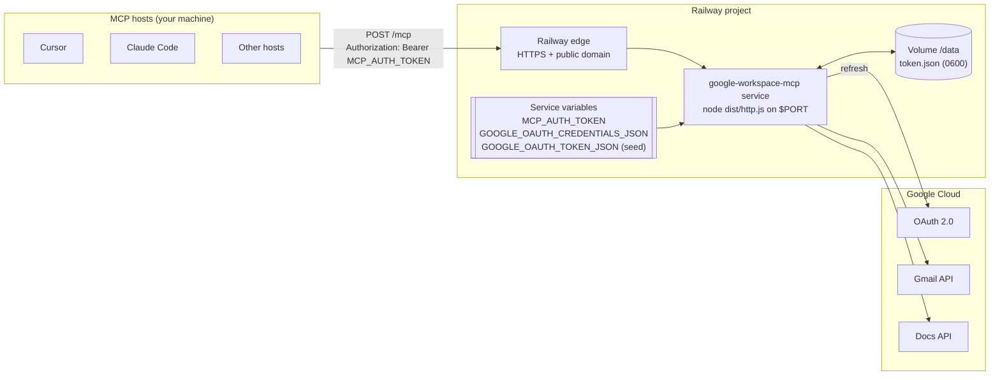

# Deployment Plan: `google-workspace-mcp` on Railway

**Status:** Coding changes implemented (container + HTTP entry + env secrets). Railway project setup (§6.3–6.6) is still manual.
**Related:** [`architecture.md`](./architecture.md), [`problemStatement.md`](./problemStatement.md)

---

## 1. Summary

Today the server is a **local, single-user, `stdio`** process. MCP hosts spawn it with `node dist/index.js` and it reads two files from disk: the OAuth client (`credentials.json`) and the refresh token (`token.json`).

Railway runs long-lived **web services** that must listen on `$PORT` and are reached over a public HTTPS URL. Deploying therefore requires four changes, in this order of importance:

1. **Protect the endpoint.** A public URL that can send email and edit Docs *as you* must reject every request without a valid secret.
2. **Add an HTTP entry point** (MCP Streamable HTTP) next to the existing stdio one.
3. **Load secrets from environment variables** instead of local files, with the token persisted on a Railway volume.
4. **Containerize** with a pinned Node 20 image and a Railway config file.

The tool logic (`server.ts`, `gmail.ts`, `docs.ts`, `validation.ts`, `errors.ts`) does not change. The stdio entry stays for local use.

> This deliberately goes beyond the MVP non-goals in `architecture.md` §1 ("HTTP transport, hosting"). It stays **single-user**: one Google account, one deployment.

---

## 2. Target Architecture



| Concern | Local today | On Railway |
| --- | --- | --- |
| Transport | stdio | Streamable HTTP at `POST /mcp` |
| Entry point | `dist/index.js` | `dist/http.js` (new) |
| Who can call tools | Only processes your OS user spawns | Anyone with the URL **and** `MCP_AUTH_TOKEN` |
| OAuth client | `credentials.json` file | `GOOGLE_OAUTH_CREDENTIALS_JSON` variable |
| Refresh token | `~/.config/google-workspace-mcp/token.json` | Seeded from `GOOGLE_OAUTH_TOKEN_JSON`, stored at `/data/token.json` on a volume |
| Initial consent | `npm run auth` (browser) | Still `npm run auth` **on your machine**; the token is then uploaded |
| Logs | stderr | stderr (Railway captures it) |

---

## 3. Security Requirements (must be done before the first deploy)

The tools perform real writes. On Railway, the host-side approval prompt is the only human check, and it only exists if the caller is *your* host. So the server itself must authenticate callers.

| # | Requirement | Detail |
| --- | --- | --- |
| S1 | Bearer token on every MCP request | `MCP_AUTH_TOKEN`: at least 32 random bytes (`openssl rand -base64 48`). Compare with `crypto.timingSafeEqual`. Missing or wrong token: `401` with `WWW-Authenticate: Bearer`, without creating an MCP server instance. |
| S2 | Fail closed | If `MCP_AUTH_TOKEN` is unset or shorter than 32 characters, the process **exits at startup**. No "open" mode. |
| S3 | Only the expected routes | `POST /mcp` (and `GET`/`DELETE` as the SDK requires), `GET /healthz`. Everything else returns `404`. |
| S4 | Body size limit | Keep the SDK default (4 MiB) or lower it to 1 MiB; tool inputs are capped at 100 KB already. |
| S5 | Secrets only in Railway variables | Never commit `credentials.json`, `token.json`, or `.env`. Add a `.dockerignore` so they never enter the image. |
| S6 | No secrets in logs | Keep the existing redacting logger; never log the `Authorization` header. |
| S7 | Single replica | One instance only. Avoids concurrent token rotation writes and keeps behavior identical to the local design. |
| S8 | Rotation | Rotating `MCP_AUTH_TOKEN` means updating the variable and every host config. Revoking Google access: [myaccount.google.com/permissions](https://myaccount.google.com/permissions). |

A static bearer token suits a single user. If you later share the server or use hosts that only support OAuth connectors, replace S1 with MCP OAuth (the SDK exports `requireBearerAuth`, `verifyBearerToken`, and protected-resource metadata helpers). That is out of scope for this plan.

---

## 4. Code Changes

### 4.1 New HTTP entry point: `src/http.ts`

Uses `createMcpHandler` from `@modelcontextprotocol/server` (already installed, v2.4.0). It returns a web-standard `fetch(Request) => Response` handler. The default `legacy: 'stateless'` mode also serves clients still on the 2025 protocol, which most hosts are today.

Sketch:

```ts
#!/usr/bin/env node
import { createServer as createHttpServer, type IncomingMessage, type ServerResponse } from 'node:http';
import { timingSafeEqual } from 'node:crypto';
import { Readable } from 'node:stream';
import { createMcpHandler } from '@modelcontextprotocol/server';
import { google } from 'googleapis';
import { AuthManager } from './auth.js';
import { loadConfig, loadDotEnv } from './config.js';
import { log } from './logger.js';
import { createServer, SERVER_VERSION, type GoogleServices } from './server.js';

loadDotEnv();
const config = loadConfig();
const auth = new AuthManager(config);

const expected = Buffer.from(process.env.MCP_AUTH_TOKEN ?? '');
if (expected.length < 32) {
  log.error('server.config_error', { error: 'MCP_AUTH_TOKEN must be set to at least 32 characters' });
  process.exit(1);
}

function authorized(header: string | undefined): boolean {
  const presented = Buffer.from(header?.startsWith('Bearer ') ? header.slice(7) : '');
  return presented.length === expected.length && timingSafeEqual(presented, expected);
}

const services: GoogleServices = {
  gmail: async () => google.gmail({ version: 'v1', auth: await auth.getAuthorizedClient() }),
  docs: async () => google.docs({ version: 'v1', auth: await auth.getAuthorizedClient() }),
};

const mcp = createMcpHandler(() => createServer(services), {
  maxRequestBodySize: 1024 * 1024,
  onerror: (err) => log.error('transport.error', { error: err.message }),
});

async function toRequest(req: IncomingMessage): Promise<Request> {
  const url = `http://${req.headers.host ?? 'localhost'}${req.url ?? '/'}`;
  const headers = new Headers();
  for (const [k, v] of Object.entries(req.headers)) if (typeof v === 'string') headers.set(k, v);
  const hasBody = req.method !== 'GET' && req.method !== 'HEAD';
  return new Request(url, {
    method: req.method,
    headers,
    body: hasBody ? (Readable.toWeb(req) as ReadableStream) : undefined,
    duplex: 'half',
  } as RequestInit);
}

async function send(res: ServerResponse, response: Response): Promise<void> {
  res.writeHead(response.status, Object.fromEntries(response.headers));
  if (response.body) Readable.fromWeb(response.body as never).pipe(res);
  else res.end();
}

const server = createHttpServer(async (req, res) => {
  const path = (req.url ?? '/').split('?')[0];
  if (req.method === 'GET' && path === '/healthz') return void res.writeHead(200).end('ok');
  if (path !== '/mcp') return void res.writeHead(404).end();
  if (!authorized(req.headers.authorization)) {
    return void res.writeHead(401, { 'WWW-Authenticate': 'Bearer' }).end();
  }
  try {
    await send(res, await mcp.fetch(await toRequest(req)));
  } catch (err) {
    log.error('http.unhandled', { error: err instanceof Error ? err.message : String(err) });
    if (!res.headersSent) res.writeHead(500).end();
  }
});

const port = Number(process.env.PORT ?? 3000);
server.listen(port, '0.0.0.0', () => log.info('server.started', { version: SERVER_VERSION, transport: 'http', port }));

for (const signal of ['SIGTERM', 'SIGINT'] as const) {
  process.on(signal, () => {
    server.close();
    void mcp.close().finally(() => process.exit(0));
  });
}
```

Notes:

- The SDK docs recommend `toNodeHandler(handler)` from `@modelcontextprotocol/node` for Node servers. If that package is published at a 2.4-compatible version, use it instead of the hand-written `toRequest`/`send` adapter. Check `npm view @modelcontextprotocol/node versions` first.
- Railway terminates TLS at its edge and forwards plain HTTP to `$PORT`. Bind to `0.0.0.0`, not `127.0.0.1`.
- `SIGTERM` is sent on redeploys. Close cleanly so in-flight writes finish rather than become `*_UNCONFIRMED`.

### 4.2 Secrets from environment: `src/config.ts` + `src/auth.ts`

Railway has no file upload for secrets, so add two optional variables. File paths keep working for local use.

| Variable | Content | Behavior |
| --- | --- | --- |
| `GOOGLE_OAUTH_CREDENTIALS_JSON` | Contents of `credentials.json` (raw JSON or base64) | If set, used instead of `GOOGLE_OAUTH_CREDENTIALS_PATH`. |
| `GOOGLE_OAUTH_TOKEN_JSON` | Contents of `token.json` (raw JSON or base64) | **Seed only.** On startup, if the file at `GOOGLE_OAUTH_TOKEN_PATH` does not exist, write this value to it with `saveToken()` (`0600`). After that, the file is the source of truth. |
| `GOOGLE_OAUTH_TOKEN_PATH` | `/data/token.json` | Points at the Railway volume. |

Why seed to a volume instead of reading the variable on every start: `AuthManager` persists rotated refresh tokens through `saveToken()`. Google rarely rotates refresh tokens for this flow, but if it does and the token lives only in a variable, the new one is lost on the next restart. With a volume, it survives.

Implementation outline:

- `config.ts`: add `credentialsJson?: string` and `tokenSeedJson?: string` to `Config`. Decode as base64 when the value does not start with `{`.
- `auth.ts`: change `readClientCredentials` to parse a JSON string, with a file-reading wrapper for the path case. Add `seedTokenIfMissing(config)`, called once from `http.ts` before `listen`.
- Never log the values. The logger already redacts token-like fields; add unit tests for the new paths.

### 4.3 Build and scripts: `package.json`

```json
"scripts": {
  "start": "node dist/index.js",
  "start:http": "node dist/http.js"
}
```

`tsconfig.build.json` already compiles all of `src/`, so `dist/http.js` is produced by `npm run build`.

### 4.4 Tests

- `tests/http.test.ts`: start the HTTP server on an ephemeral port with a test token.
  - No `Authorization` header returns `401`, and the tool handlers are never invoked.
  - Wrong token returns `401`; correct token plus `initialize` and `tools/list` returns exactly two tools.
  - `GET /healthz` returns `200` without auth; unknown paths return `404`.
  - Startup with a missing or short `MCP_AUTH_TOKEN` exits non-zero.
- `tests/auth.test.ts`: credentials from a JSON string and from base64; token seeding writes `0600` and does not overwrite an existing file.

---

## 5. Container and Railway Configuration

### 5.1 `Dockerfile`

A Dockerfile pins the Node version. The host `node` on this machine defaults to 18, and the project needs 20.12 or newer (`util.parseEnv`). Railway's auto-builder may also pick a version you do not expect.

```dockerfile
FROM node:20.19.6-slim AS build
WORKDIR /app
COPY package.json package-lock.json ./
RUN npm ci
COPY tsconfig.json tsconfig.build.json ./
COPY src ./src
RUN npm run build && npm prune --omit=dev

FROM node:20.19.6-slim
ENV NODE_ENV=production
WORKDIR /app
COPY --from=build /app/package.json ./
COPY --from=build /app/node_modules ./node_modules
COPY --from=build /app/dist ./dist
USER node
CMD ["node", "dist/http.js"]
```

The volume is mounted as root by default. If `/data/token.json` cannot be written as the `node` user, either drop `USER node` or set the Railway variable `RAILWAY_RUN_UID=0`. Verify this during the first deploy (step 6.4).

### 5.2 `.dockerignore`

```text
node_modules
dist
.env
.env.*
credentials*.json
*token*.json
secrets
tests
docs
.git
```

### 5.3 `railway.json`

```json
{
  "$schema": "https://railway.com/railway.schema.json",
  "build": {
    "builder": "DOCKERFILE",
    "dockerfilePath": "Dockerfile"
  },
  "deploy": {
    "numReplicas": 1,
    "healthcheckPath": "/healthz",
    "healthcheckTimeout": 60,
    "restartPolicyType": "ON_FAILURE",
    "restartPolicyMaxRetries": 5
  }
}
```

### 5.4 Railway service variables

| Variable | Value | Notes |
| --- | --- | --- |
| `MCP_AUTH_TOKEN` | Output of `openssl rand -base64 48` | Required. Store it in a password manager too. |
| `GOOGLE_OAUTH_CREDENTIALS_JSON` | `base64 -i credentials.json` | Required. |
| `GOOGLE_OAUTH_TOKEN_JSON` | `base64 -i ~/.config/google-workspace-mcp/token.json` | Required for the first boot only. |
| `GOOGLE_OAUTH_TOKEN_PATH` | `/data/token.json` | Must be on the volume. |
| `LOG_LEVEL` | `info` | Optional. |
| `PORT` | (set by Railway) | Do not set manually. |

---

## 6. Deployment Steps

### 6.1 Google Cloud checks (once)

1. Keep the existing **Desktop app** OAuth client. Consent still happens locally through `npm run auth`, so the loopback redirect continues to work; no Web client or Railway redirect URI is needed.
2. **Publishing status matters.** If the consent screen is *External* and in **Testing** status, Google expires refresh tokens after **7 days**. The deployed server would then fail with `AUTH_EXPIRED` every week. Choose one:
   - Set the app to **In production**. For personal use with the sensitive `gmail.send` scope, an unverified app shows a warning screen to you but works.
   - Or use an *Internal* app if your account is in a Google Workspace organization that allows it.
   - Or accept weekly re-authorization (step 7.2).
3. If your organization restricts third-party OAuth apps or hosting tokens on external platforms, get approval before uploading the refresh token to Railway.

### 6.2 Implement and verify locally

```bash
nvm use                      # Node 20.19.6 from .nvmrc
npm run typecheck && npm run lint && npm test
npm run build

MCP_AUTH_TOKEN="$(openssl rand -base64 48)" PORT=3000 npm run start:http
```

In another terminal:

```bash
curl -i http://localhost:3000/healthz                        # 200
curl -i -X POST http://localhost:3000/mcp                    # 401
npx @modelcontextprotocol/inspector                          # Streamable HTTP, URL http://localhost:3000/mcp,
                                                             # header Authorization: Bearer <token>
```

Also build and run the container to check Node version, file permissions, and that no secrets were copied:

```bash
docker build -t google-workspace-mcp .
docker run --rm google-workspace-mcp ls -la /app             # no credentials/token/.env
```

### 6.3 Create the Railway project

```bash
npm i -g @railway/cli
railway login
railway init                    # new project, e.g. google-workspace-mcp
```

Or connect the GitHub repository in the Railway dashboard (recommended, so deploys follow `main`). Confirm the repository is **private**, even though secrets are ignored.

### 6.4 Volume, variables, domain

1. In the service, add a **Volume** mounted at `/data`.
2. Set the variables from §5.4 (dashboard **Variables** tab, or `railway variables --set "KEY=value"`).
3. Under **Settings → Networking**, generate a Railway domain, e.g. `https://google-workspace-mcp-production.up.railway.app`.

### 6.5 Deploy and verify

```bash
railway up                      # or push to the connected branch
railway logs                    # expect server.started with transport "http"
```

```bash
URL=https://<your-domain>.up.railway.app
curl -i $URL/healthz                                         # 200
curl -i -X POST $URL/mcp                                     # 401
```

Then connect MCP Inspector to `$URL/mcp` with the bearer header. Run `tools/list` (expect two tools) and one call with **invalid** input (expect `VALIDATION_ERROR`, no Google call).

After the first successful start, **delete `GOOGLE_OAUTH_TOKEN_JSON`** from the Railway variables. The token now lives on the volume, so the variable is just a second copy of the secret.

### 6.6 End-to-end checks (test account, as in `problemStatement.md` §10)

1. `send_email` to an address you own; confirm it arrives and appears in Sent.
2. `append_to_google_doc` to a test document; confirm the text is at the end.
3. Redeploy; confirm a tool call still works (token survived on the volume).
4. Check `railway logs` contain no email bodies, document text, or tokens.

---

## 7. Connecting MCP Hosts

All hosts use the URL `https://<your-domain>.up.railway.app/mcp` and the header `Authorization: Bearer <MCP_AUTH_TOKEN>`. Keep host approval prompts on; do not enable auto-approve.

**Cursor** (`~/.cursor/mcp.json`). Cursor supports `${env:VAR}` interpolation, which keeps the token out of the file:

```json
{
  "mcpServers": {
    "google-workspace": {
      "url": "https://<your-domain>.up.railway.app/mcp",
      "headers": { "Authorization": "Bearer ${env:GOOGLE_WORKSPACE_MCP_TOKEN}" }
    }
  }
}
```

**Claude Code:**

```bash
claude mcp add --transport http google-workspace https://<your-domain>.up.railway.app/mcp \
  --header "Authorization: Bearer $GOOGLE_WORKSPACE_MCP_TOKEN"
```

**Claude Desktop / Antigravity:** remote-server support and header options differ by version. If a host only accepts OAuth-based remote connectors, either keep using the local stdio entry for that host, or bridge with `npx mcp-remote <url> --header "Authorization: Bearer ..."`. Check each host's current docs before relying on this.

### 7.1 Local and remote together

The local stdio setup keeps working. Running both against the same Google account is fine; they hold independent copies of the refresh token.

### 7.2 Re-authorizing the deployed server

When tools return `AUTH_EXPIRED` or `AUTH_REQUIRED`:

```bash
nvm use && npm run auth                                       # locally, refreshes ~/.config/.../token.json
```

Then put the new token on the volume. Either delete `/data/token.json` (`railway ssh`, then `rm /data/token.json`), set `GOOGLE_OAUTH_TOKEN_JSON` again, and redeploy. Or add a small authenticated admin route later; it is not in scope here.

---

## 8. Operations

| Topic | Plan |
| --- | --- |
| Health | Railway healthcheck on `/healthz` (process liveness only; it does not call Google). |
| Logs | `railway logs`. Existing structured stderr logs with redaction. |
| Restarts | `ON_FAILURE`, 5 retries. `SIGTERM` handled for clean redeploys. |
| Scaling | Fixed at 1 replica (S7). The workload is a few calls per day. |
| Sleep / serverless | If you enable Railway's app sleeping to save cost, the first call after idle is slow. Hosts may time out once; tools still never auto-retry writes. |
| Cost | One small always-on service plus a 1 GB volume. Check current Railway pricing for your plan. |
| Rollback | Railway dashboard → **Deployments** → redeploy the previous successful deployment. The volume is unaffected. |
| Kill switch | Remove or change `MCP_AUTH_TOKEN` (instantly blocks all callers), or revoke the app at [myaccount.google.com/permissions](https://myaccount.google.com/permissions) (blocks Google access). |

---

## 9. Risks

| Risk | Impact | Mitigation |
| --- | --- | --- |
| `MCP_AUTH_TOKEN` leaks (shell history, shared config) | Anyone can send email as you | Long random token, env interpolation in host configs, rotate on suspicion, Google revoke as backstop. |
| Prompt injection through a host | Unwanted writes | Unchanged from local design: host approval, tool descriptions, no auto-approve. |
| Refresh token expires after 7 days (Testing status) | Weekly `AUTH_EXPIRED` | Publish the consent screen (§6.1). |
| Volume not writable by `node` user | Seeding or rotation fails | Verified at step 6.4; fix with `RAILWAY_RUN_UID=0` or by removing `USER node`. |
| Host lacks header support for remote servers | Cannot connect | Use the local stdio entry or `mcp-remote` for that host. |
| Org policy forbids storing Google tokens on third-party hosting | Compliance issue | Confirm before step 6.4. |

---

## 10. Work Checklist

- [ ] §6.1 Google consent screen publishing status decided
- [x] §4.1 `src/http.ts` with bearer auth, `/healthz`, graceful shutdown
- [x] §4.2 `GOOGLE_OAUTH_CREDENTIALS_JSON` / `GOOGLE_OAUTH_TOKEN_JSON` support and token seeding
- [x] §4.3 `start:http` script
- [x] §4.4 HTTP and auth tests passing
- [x] §5 `Dockerfile`, `.dockerignore`, `railway.json`
- [ ] §6.2 Local HTTP and container verification
- [ ] §6.3–6.5 Railway project, volume, variables, domain, deploy
- [ ] §6.5 `GOOGLE_OAUTH_TOKEN_JSON` removed after first boot
- [ ] §6.6 End-to-end checks
- [x] §7 Host configs updated; README section "Remote deployment (Railway)" added
