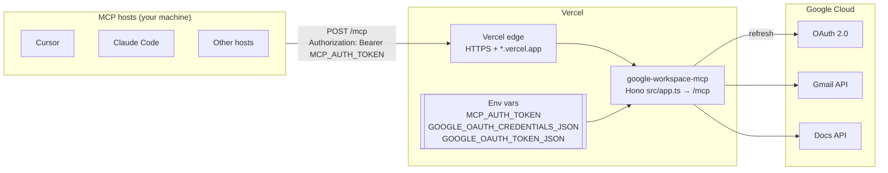

# Deployment Plan: `google-workspace-mcp` on Vercel

**Status:** Coding changes implemented (Hono/`src/app.ts` entry + env-backed Google token + `vercel.json`). Project link and env vars in the Vercel dashboard (§6.3–6.5) are still manual.
**Related:** [`architecture.md`](./architecture.md), [`problemStatement.md`](./problemStatement.md)

---

## 1. Summary

Today the server is a **local, single-user, `stdio`** process. MCP hosts spawn it with `node dist/index.js` and it reads two files from disk: the OAuth client (`credentials.json`) and the refresh token (`token.json`).

Vercel runs the MCP endpoint as a **serverless Function** (Hono on Fluid compute) behind HTTPS. Deploying therefore requires:

1. **Protect the endpoint.** A public URL that can send email and edit Docs *as you* must reject every request without a valid secret.
2. **Serve Streamable HTTP** from a Vercel-recognized entry (`src/app.ts`) next to the existing stdio and Node HTTP entries.
3. **Load secrets from environment variables** (no persistent disk — unlike Render). Keep `GOOGLE_OAUTH_TOKEN_JSON` set permanently.
4. **Deploy** with the Vercel CLI or a Git-connected project (`vercel.json`).

The tool logic (`server.ts`, `gmail.ts`, `docs.ts`, `validation.ts`, `errors.ts`) does not change. Stdio stays for local use; `npm run start:http` / Docker remain optional for non-Vercel hosts.

> This deliberately goes beyond the MVP non-goals in `architecture.md` §1 ("HTTP transport, hosting"). It stays **single-user**: one Google account, one deployment.

---

## 2. Target Architecture



| Concern | Local today | On Vercel |
| --- | --- | --- |
| Transport | stdio | Streamable HTTP at `POST /mcp` |
| Entry point | `dist/index.js` | `src/app.ts` (Hono default export) |
| Who can call tools | Only processes your OS user spawns | Anyone with the URL **and** `MCP_AUTH_TOKEN` |
| OAuth client | `credentials.json` file | `GOOGLE_OAUTH_CREDENTIALS_JSON` variable |
| Refresh token | `~/.config/google-workspace-mcp/token.json` | `GOOGLE_OAUTH_TOKEN_JSON` (always set; optional `/tmp` seed) |
| Initial consent | `npm run auth` (browser) | Still `npm run auth` **on your machine**; upload the token JSON |
| Logs | stderr | Vercel **Runtime Logs** |

---

## 3. Security Requirements (must be done before the first deploy)

The tools perform real writes. On Vercel, the host-side approval prompt is the only human check, and it only exists if the caller is *your* host. So the server itself must authenticate callers.

| # | Requirement | Detail |
| --- | --- | --- |
| S1 | Bearer token on every MCP request | `MCP_AUTH_TOKEN`: at least 32 random bytes (`openssl rand -base64 48`). Compare with `crypto.timingSafeEqual`. Missing or wrong token: `401` with `WWW-Authenticate: Bearer`, without creating an MCP server instance. |
| S2 | Fail closed | If `MCP_AUTH_TOKEN` is unset or shorter than 32 characters, the process **throws at startup**. No "open" mode. |
| S3 | Only the expected routes | `POST /mcp` (and `GET`/`DELETE` as the SDK requires), `GET /healthz`. Everything else returns `404`. |
| S4 | Body size limit | 1 MiB; tool inputs are capped at 100 KB already. |
| S5 | Secrets only in Vercel env vars | Never commit `credentials.json`, `token.json`, or `.env`. `.vercelignore` excludes them from uploads. |
| S6 | No secrets in logs | Keep the existing redacting logger; never log the `Authorization` header. |
| S7 | Stateless | Each invocation can land on a different instance. Token durability comes from env vars, not disk. |
| S8 | Rotation | Rotating `MCP_AUTH_TOKEN` means updating the variable and every host config. Revoking Google access: [myaccount.google.com/permissions](https://myaccount.google.com/permissions). |

A static bearer token suits a single user. MCP OAuth helpers exist in the SDK but are out of scope for this plan.

---

## 4. Code Changes

### 4.1 Vercel entry: `src/app.ts` + `src/create-app.ts`

Uses `createMcpHonoApp` from `@modelcontextprotocol/hono` and `createMcpHandler` from `@modelcontextprotocol/server`. Bearer auth gates `/mcp`; `/healthz` is open. Vercel recognizes `src/app.ts` as a Hono default export.

Host validation: on Vercel, `allowedHosts` is built from `VERCEL_URL`, `VERCEL_BRANCH_URL`, `VERCEL_PROJECT_PRODUCTION_URL`, plus optional `MCP_ALLOWED_HOSTS` (custom domains).

### 4.2 Secrets from environment: `src/config.ts` + `src/auth.ts`

| Variable | Content | Behavior |
| --- | --- | --- |
| `GOOGLE_OAUTH_CREDENTIALS_JSON` | Contents of `credentials.json` (raw JSON or base64) | If set, used instead of `GOOGLE_OAUTH_CREDENTIALS_PATH`. |
| `GOOGLE_OAUTH_TOKEN_JSON` | Contents of `token.json` (raw JSON or base64) | **Durable source of truth on Vercel.** `AuthManager` falls back to this when no token file exists. |
| `GOOGLE_OAUTH_TOKEN_PATH` | `/tmp/google-workspace-mcp-token.json` (auto on Vercel) | Opportunistic seed only; `/tmp` is not durable across cold starts. |

Desktop-app refresh tokens rarely rotate. If Google does issue a new refresh token and only `/tmp` was updated, update `GOOGLE_OAUTH_TOKEN_JSON` in Vercel after a local `npm run auth`.

### 4.3 Build and scripts

- `npm run start` — stdio (`dist/index.js`)
- `npm run start:http` — long-lived Node HTTP (`dist/http.js`), useful locally / Docker
- `npm run deploy` — `vercel deploy --prod`

### 4.4 Tests

- `tests/http.test.ts`: Node HTTP bearer auth, `/healthz`, fail-closed without `MCP_AUTH_TOKEN`.
- `tests/app.test.ts`: Hono app bearer auth, `/healthz`, initialize.
- `tests/auth.test.ts`: credentials from JSON/base64; `loadStoredToken` env fallback; token seeding.

---

## 5. Vercel Configuration

### 5.1 `vercel.json`

```json
{
  "framework": "hono",
  "regions": ["iad1"],
  "functions": {
    "src/app.ts": {
      "maxDuration": 60,
      "memory": 1024
    }
  }
}
```

`maxDuration: 60` covers Gmail/Docs latency on the hobby/pro function limits. Adjust the region to one near you if preferred.

### 5.2 `.vercelignore`

Excludes `node_modules`, `dist`, secrets, tests, docs, and the optional Docker/Render leftovers from CLI uploads.

### 5.3 Environment variables

| Variable | Value | Notes |
| --- | --- | --- |
| `MCP_AUTH_TOKEN` | Output of `openssl rand -base64 48` | Required. Store it in a password manager too. |
| `GOOGLE_OAUTH_CREDENTIALS_JSON` | `base64 < credentials.json` | Required. |
| `GOOGLE_OAUTH_TOKEN_JSON` | `base64 < ~/.config/google-workspace-mcp/token.json` | Required; **keep set** (unlike the old Render disk seed). |
| `MCP_ALLOWED_HOSTS` | Custom domain hostnames | Optional. |
| `LOG_LEVEL` | `info` | Optional. |

Encode secrets locally (macOS):

```bash
openssl rand -base64 48
base64 < credentials.json | tr -d '\n'
base64 < ~/.config/google-workspace-mcp/token.json | tr -d '\n'
```

---

## 6. Deployment Steps

### 6.1 Google Cloud checks (once)

1. Keep the existing **Desktop app** OAuth client. Consent still happens locally through `npm run auth`.
2. **Publishing status matters.** If the consent screen is *External* and in **Testing** status, Google expires refresh tokens after **7 days**. Prefer **In production** (or *Internal* for Workspace).
3. Confirm org policy allows storing the refresh token on Vercel before uploading it.

### 6.2 Implement and verify locally

```bash
nvm use                      # Node 20.19.6 from .nvmrc
npm run typecheck && npm run lint && npm test
npm run build

MCP_AUTH_TOKEN="$(openssl rand -base64 48)" PORT=3000 npm run start:http
```

In another terminal:

```bash
curl -i http://localhost:3000/healthz                        # 200
curl -i -X POST http://localhost:3000/mcp                    # 401
```

Optional: `npx vercel dev` (uses `src/app.ts`) after setting env vars in the Vercel project or a linked `.env`.

### 6.3 Create the Vercel project

1. Push this repo to GitHub (private recommended), **or** deploy from the CLI only.
2. Install CLI if needed: `npm i -g vercel` (or use `npx vercel`).
3. From the project root:

```bash
npx vercel login
npx vercel link          # create/link project
npx vercel env add MCP_AUTH_TOKEN production
npx vercel env add GOOGLE_OAUTH_CREDENTIALS_JSON production
npx vercel env add GOOGLE_OAUTH_TOKEN_JSON production
# repeat for Preview if you want preview deployments to work
npx vercel deploy --prod
```

Hobby (free) works for this workload — no credit card required for the free tier’s normal limits. Enable Fluid compute if the dashboard offers a toggle (often on by default).

### 6.4 Deploy and verify

```bash
URL=https://<your-project>.vercel.app
curl -i $URL/healthz                                         # 200
curl -i -X POST $URL/mcp                                     # 401
```

Connect MCP Inspector to `$URL/mcp` with the bearer header. Run `tools/list` (expect two tools) and one call with **invalid** input (expect `VALIDATION_ERROR`, no Google call).

### 6.5 End-to-end checks (test account)

1. `send_email` to an address you own; confirm it arrives and appears in Sent.
2. `append_to_google_doc` to a test document; confirm the text is at the end.
3. Redeploy / wait for a cold start; confirm a tool call still works (token came from env).
4. Check Vercel logs contain no email bodies, document text, or tokens.

---

## 7. Connecting MCP Hosts

All hosts use `https://<your-project>.vercel.app/mcp` and `Authorization: Bearer <MCP_AUTH_TOKEN>`. Keep host approval prompts on.

**Cursor** (`~/.cursor/mcp.json`) — see [`examples/cursor.vercel.mcp.json`](../examples/cursor.vercel.mcp.json):

```json
{
  "mcpServers": {
    "google-workspace": {
      "url": "https://<your-project>.vercel.app/mcp",
      "headers": { "Authorization": "Bearer ${env:GOOGLE_WORKSPACE_MCP_TOKEN}" }
    }
  }
}
```

**Claude Code:**

```bash
claude mcp add --transport http google-workspace https://<your-project>.vercel.app/mcp \
  --header "Authorization: Bearer $GOOGLE_WORKSPACE_MCP_TOKEN"
```

### 7.1 Local and remote together

Local stdio keeps working. Both may target the same Google account with independent token copies.

### 7.2 Re-authorizing the deployed server

When tools return `AUTH_EXPIRED` or `AUTH_REQUIRED`:

```bash
nvm use && npm run auth
base64 < ~/.config/google-workspace-mcp/token.json | tr -d '\n'
```

Update `GOOGLE_OAUTH_TOKEN_JSON` in the Vercel project (Production + Preview as needed) and redeploy (or rely on env change + next invocation, depending on how you set the var).

---

## 8. Operations

| Topic | Plan |
| --- | --- |
| Health | `GET /healthz` (liveness only; does not call Google). |
| Logs | Vercel dashboard → project → **Logs**. Structured stderr with redaction. |
| Cold starts | First request after idle can be slower; Fluid compute reduces idle cost. |
| Scaling | Platform scales the Function; workload is a few calls per day. |
| Cost | Hobby free tier is enough for personal use; watch function duration limits. |
| Rollback | Vercel **Instant Rollback** / promote a previous deployment. |
| Kill switch | Change or remove `MCP_AUTH_TOKEN`, or revoke Google access at [myaccount.google.com/permissions](https://myaccount.google.com/permissions). |

---

## 9. Risks

| Risk | Impact | Mitigation |
| --- | --- | --- |
| `MCP_AUTH_TOKEN` leaks | Anyone can send email as you | Long random token, env interpolation in host configs, rotate on suspicion, Google revoke as backstop. |
| Prompt injection through a host | Unwanted writes | Unchanged: host approval, tool descriptions, no auto-approve. |
| Refresh token expires after 7 days (Testing status) | Weekly `AUTH_EXPIRED` | Publish the consent screen (§6.1). |
| No durable disk; rotated refresh token only in `/tmp` | Next cold start uses stale env token | Keep `GOOGLE_OAUTH_TOKEN_JSON` updated; Desktop apps rarely rotate refresh tokens. |
| Host lacks header support for remote servers | Cannot connect | Use local stdio or `mcp-remote`. |
| Org policy forbids storing Google tokens on Vercel | Compliance issue | Confirm before §6.3. |
| Function timeout | Tool call fails mid-flight | `maxDuration: 60`; uncertain writes already surface as `*_UNCONFIRMED`. |

---

## 10. Work Checklist

- [ ] §6.1 Google consent screen publishing status decided
- [x] §4.1 `src/app.ts` / `src/create-app.ts` with bearer auth, `/healthz`
- [x] §4.2 Env-backed token load (`loadStoredToken`) + optional `/tmp` seed on Vercel
- [x] §4.3 Scripts; Node HTTP entry kept for local use
- [x] §4.4 HTTP / Hono / auth tests
- [x] §5 `vercel.json`, `.vercelignore`
- [ ] §6.2 Local HTTP verification
- [ ] §6.3–6.4 Vercel project, env vars, deploy
- [ ] §6.5 End-to-end checks
- [x] §7 Host config example; README section for Vercel
