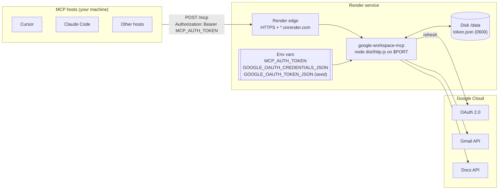

# Deployment Plan: `google-workspace-mcp` on Render

**Status:** Coding changes implemented (container + HTTP entry + env secrets + Render Blueprint). Render project setup (§6.3–6.6) is still manual.
**Related:** [`architecture.md`](./architecture.md), [`problemStatement.md`](./problemStatement.md)

---

## 1. Summary

Today the server is a **local, single-user, `stdio`** process. MCP hosts spawn it with `node dist/index.js` and it reads two files from disk: the OAuth client (`credentials.json`) and the refresh token (`token.json`).

Render runs long-lived **web services** that must listen on `$PORT` and are reached over a public HTTPS URL. Deploying therefore requires four changes, in this order of importance:

1. **Protect the endpoint.** A public URL that can send email and edit Docs *as you* must reject every request without a valid secret.
2. **Add an HTTP entry point** (MCP Streamable HTTP) next to the existing stdio one.
3. **Load secrets from environment variables** instead of local files, with the token persisted on a Render disk.
4. **Containerize** with a pinned Node 20 image and a `render.yaml` Blueprint.

The tool logic (`server.ts`, `gmail.ts`, `docs.ts`, `validation.ts`, `errors.ts`) does not change. The stdio entry stays for local use.

> This deliberately goes beyond the MVP non-goals in `architecture.md` §1 ("HTTP transport, hosting"). It stays **single-user**: one Google account, one deployment.

---

## 2. Target Architecture



| Concern | Local today | On Render |
| --- | --- | --- |
| Transport | stdio | Streamable HTTP at `POST /mcp` |
| Entry point | `dist/index.js` | `dist/http.js` (new) |
| Who can call tools | Only processes your OS user spawns | Anyone with the URL **and** `MCP_AUTH_TOKEN` |
| OAuth client | `credentials.json` file | `GOOGLE_OAUTH_CREDENTIALS_JSON` variable |
| Refresh token | `~/.config/google-workspace-mcp/token.json` | Seeded from `GOOGLE_OAUTH_TOKEN_JSON`, stored at `/data/token.json` on a disk |
| Initial consent | `npm run auth` (browser) | Still `npm run auth` **on your machine**; the token is then uploaded |
| Logs | stderr | stderr (Render captures it) |

---

## 3. Security Requirements (must be done before the first deploy)

The tools perform real writes. On Render, the host-side approval prompt is the only human check, and it only exists if the caller is *your* host. So the server itself must authenticate callers.

| # | Requirement | Detail |
| --- | --- | --- |
| S1 | Bearer token on every MCP request | `MCP_AUTH_TOKEN`: at least 32 random bytes (`openssl rand -base64 48`). Compare with `crypto.timingSafeEqual`. Missing or wrong token: `401` with `WWW-Authenticate: Bearer`, without creating an MCP server instance. |
| S2 | Fail closed | If `MCP_AUTH_TOKEN` is unset or shorter than 32 characters, the process **exits at startup**. No "open" mode. |
| S3 | Only the expected routes | `POST /mcp` (and `GET`/`DELETE` as the SDK requires), `GET /healthz`. Everything else returns `404`. |
| S4 | Body size limit | Keep the SDK default (4 MiB) or lower it to 1 MiB; tool inputs are capped at 100 KB already. |
| S5 | Secrets only in Render env vars | Never commit `credentials.json`, `token.json`, or `.env`. Add a `.dockerignore` so they never enter the image. |
| S6 | No secrets in logs | Keep the existing redacting logger; never log the `Authorization` header. |
| S7 | Single replica | One instance only. Avoids concurrent token rotation writes and keeps behavior identical to the local design. |
| S8 | Rotation | Rotating `MCP_AUTH_TOKEN` means updating the variable and every host config. Revoking Google access: [myaccount.google.com/permissions](https://myaccount.google.com/permissions). |

A static bearer token suits a single user. If you later share the server or use hosts that only support OAuth connectors, replace S1 with MCP OAuth (the SDK exports `requireBearerAuth`, `verifyBearerToken`, and protected-resource metadata helpers). That is out of scope for this plan.

---

## 4. Code Changes

### 4.1 New HTTP entry point: `src/http.ts`

Uses `createMcpHandler` from `@modelcontextprotocol/server` (already installed) plus `toNodeHandler` from `@modelcontextprotocol/node`. Bearer auth gates `/mcp`; `/healthz` is open for the platform health check. Binds to `0.0.0.0` on `$PORT`. Handles `SIGTERM`/`SIGINT` for clean redeploys.

Notes:

- Render terminates TLS at its edge and forwards plain HTTP to `$PORT`. Bind to `0.0.0.0`, not `127.0.0.1`.
- `SIGTERM` is sent on redeploys. Close cleanly so in-flight writes finish rather than become `*_UNCONFIRMED`.

### 4.2 Secrets from environment: `src/config.ts` + `src/auth.ts`

Render has no file upload for secrets, so add two optional variables. File paths keep working for local use.

| Variable | Content | Behavior |
| --- | --- | --- |
| `GOOGLE_OAUTH_CREDENTIALS_JSON` | Contents of `credentials.json` (raw JSON or base64) | If set, used instead of `GOOGLE_OAUTH_CREDENTIALS_PATH`. |
| `GOOGLE_OAUTH_TOKEN_JSON` | Contents of `token.json` (raw JSON or base64) | **Seed only.** On startup, if the file at `GOOGLE_OAUTH_TOKEN_PATH` does not exist, write this value to it with `saveToken()` (`0600`). After that, the file is the source of truth. |
| `GOOGLE_OAUTH_TOKEN_PATH` | `/data/token.json` | Points at the Render disk. |

Why seed to a disk instead of reading the variable on every start: `AuthManager` persists rotated refresh tokens through `saveToken()`. Google rarely rotates refresh tokens for this flow, but if it does and the token lives only in a variable, the new one is lost on the next restart. With a disk, it survives.

### 4.3 Build and scripts: `package.json`

```json
"scripts": {
  "start": "node dist/index.js",
  "start:http": "node dist/http.js"
}
```

`tsconfig.build.json` already compiles all of `src/`, so `dist/http.js` is produced by `npm run build`.

### 4.4 Tests

- `tests/http.test.ts`: bearer auth, `/healthz`, startup fail-closed without `MCP_AUTH_TOKEN`.
- `tests/auth.test.ts`: credentials from JSON/base64; token seeding writes `0600` and does not overwrite an existing file.

---

## 5. Container and Render Configuration

### 5.1 `Dockerfile` + `docker-entrypoint.sh`

A Dockerfile pins the Node version. The host `node` on this machine defaults to 18, and the project needs 20.12 or newer (`util.parseEnv`).

```dockerfile
FROM node:20.19.6-slim AS build
WORKDIR /app
COPY package.json package-lock.json ./
RUN npm ci
COPY tsconfig.json tsconfig.build.json ./
COPY src ./src
RUN npm run build && npm prune --omit=dev

FROM node:20.19.6-slim
ENV NODE_ENV=production
WORKDIR /app
COPY --from=build /app/package.json ./
COPY --from=build /app/node_modules ./node_modules
COPY --from=build /app/dist ./dist
COPY docker-entrypoint.sh /usr/local/bin/docker-entrypoint.sh
RUN chmod 755 /usr/local/bin/docker-entrypoint.sh
ENTRYPOINT ["docker-entrypoint.sh"]
CMD ["node", "dist/http.js"]
```

Render mounts the persistent disk as root. The entrypoint `chown`s `/data` to the `node` user, then drops privileges with `setpriv` before starting the app. Without that, seeding `/data/token.json` fails.

### 5.2 `.dockerignore`

```text
node_modules
dist
.env
.env.*
credentials*.json
*token*.json
secrets
tests
docs
.git
```

### 5.3 `render.yaml`

```yaml
services:
  - type: web
    name: google-workspace-mcp
    runtime: docker
    dockerfilePath: ./Dockerfile
    plan: 0.5c-512mb
    numInstances: 1
    healthCheckPath: /healthz
    disk:
      name: mcp-data
      mountPath: /data
      sizeGB: 1
    envVars:
      - key: NODE_ENV
        value: production
      - key: LOG_LEVEL
        value: info
      - key: GOOGLE_OAUTH_TOKEN_PATH
        value: /data/token.json
      - key: MCP_AUTH_TOKEN
        sync: false
      - key: GOOGLE_OAUTH_CREDENTIALS_JSON
        sync: false
      - key: GOOGLE_OAUTH_TOKEN_JSON
        sync: false
```

`sync: false` means you fill those secrets in the Render dashboard (they are not stored in git).

**Do not use `plan: free`** for this service: free web services sleep after ~15 minutes idle (MCP hosts then time out on cold start), and free instances cannot attach a persistent disk. Use at least `0.5c-512mb`.

### 5.4 Render service variables

| Variable | Value | Notes |
| --- | --- | --- |
| `MCP_AUTH_TOKEN` | Output of `openssl rand -base64 48` | Required. Store it in a password manager too. |
| `GOOGLE_OAUTH_CREDENTIALS_JSON` | `base64 < credentials.json` | Required. |
| `GOOGLE_OAUTH_TOKEN_JSON` | `base64 < ~/.config/google-workspace-mcp/token.json` | Required for the first boot only. |
| `GOOGLE_OAUTH_TOKEN_PATH` | `/data/token.json` | Set by `render.yaml`; must be on the disk. |
| `LOG_LEVEL` | `info` | Optional. |
| `PORT` | (set by Render) | Do not set manually. |

---

## 6. Deployment Steps

### 6.1 Google Cloud checks (once)

1. Keep the existing **Desktop app** OAuth client. Consent still happens locally through `npm run auth`, so the loopback redirect continues to work; no Web client or Render redirect URI is needed.
2. **Publishing status matters.** If the consent screen is *External* and in **Testing** status, Google expires refresh tokens after **7 days**. The deployed server would then fail with `AUTH_EXPIRED` every week. Choose one:
   - Set the app to **In production**. For personal use with the sensitive `gmail.send` scope, an unverified app shows a warning screen to you but works.
   - Or use an *Internal* app if your account is in a Google Workspace organization that allows it.
   - Or accept weekly re-authorization (step 7.2).
3. If your organization restricts third-party OAuth apps or hosting tokens on external platforms, get approval before uploading the refresh token to Render.

### 6.2 Implement and verify locally

```bash
nvm use                      # Node 20.19.6 from .nvmrc
npm run typecheck && npm run lint && npm test
npm run build

MCP_AUTH_TOKEN="$(openssl rand -base64 48)" PORT=3000 npm run start:http
```

In another terminal:

```bash
curl -i http://localhost:3000/healthz                        # 200
curl -i -X POST http://localhost:3000/mcp                    # 401
npx @modelcontextprotocol/inspector                          # Streamable HTTP, URL http://localhost:3000/mcp,
                                                             # header Authorization: Bearer <token>
```

Also build and run the container to check Node version, file permissions, and that no secrets were copied:

```bash
docker build -t google-workspace-mcp .
docker run --rm google-workspace-mcp ls -la /app             # no credentials/token/.env
```

### 6.3 Create the Render service

1. Push this repo to GitHub (private recommended).
2. In the [Render dashboard](https://dashboard.render.com/): **New → Blueprint**, select the repo (uses `render.yaml`), **or** **New → Web Service**, connect the repo, and set **Runtime: Docker**.
3. Confirm plan is **`0.5c-512mb`** (or higher) and a **disk** is mounted at `/data` (1 GB is enough).

### 6.4 Variables and domain

1. Under **Environment**, set the secrets from §5.4 (`MCP_AUTH_TOKEN`, `GOOGLE_OAUTH_CREDENTIALS_JSON`, `GOOGLE_OAUTH_TOKEN_JSON`). `GOOGLE_OAUTH_TOKEN_PATH` is already `/data/token.json` via the Blueprint.
2. Render assigns a public URL such as `https://google-workspace-mcp.onrender.com`. Custom domains are optional.

Encode secrets locally (macOS):

```bash
openssl rand -base64 48
base64 < credentials.json | tr -d '\n'
base64 < ~/.config/google-workspace-mcp/token.json | tr -d '\n'
```

### 6.5 Deploy and verify

Deploy happens automatically on push when the repo is connected, or click **Manual Deploy** in the dashboard. In **Logs**, expect `server.started` with `transport: "http"`.

```bash
URL=https://<your-service>.onrender.com
curl -i $URL/healthz                                         # 200
curl -i -X POST $URL/mcp                                     # 401
```

Then connect MCP Inspector to `$URL/mcp` with the bearer header. Run `tools/list` (expect two tools) and one call with **invalid** input (expect `VALIDATION_ERROR`, no Google call).

After the first successful start, **delete `GOOGLE_OAUTH_TOKEN_JSON`** from the Render env vars and redeploy (or clear + save). The token now lives on the disk, so the variable is just a second copy of the secret.

### 6.6 End-to-end checks (test account, as in `problemStatement.md` §10)

1. `send_email` to an address you own; confirm it arrives and appears in Sent.
2. `append_to_google_doc` to a test document; confirm the text is at the end.
3. Redeploy; confirm a tool call still works (token survived on the disk).
4. Check Render logs contain no email bodies, document text, or tokens.

---

## 7. Connecting MCP Hosts

All hosts use the URL `https://<your-service>.onrender.com/mcp` and the header `Authorization: Bearer <MCP_AUTH_TOKEN>`. Keep host approval prompts on; do not enable auto-approve.

**Cursor** (`~/.cursor/mcp.json`). Cursor supports `${env:VAR}` interpolation, which keeps the token out of the file. See also [`examples/cursor.render.mcp.json`](../examples/cursor.render.mcp.json):

```json
{
  "mcpServers": {
    "google-workspace": {
      "url": "https://<your-service>.onrender.com/mcp",
      "headers": { "Authorization": "Bearer ${env:GOOGLE_WORKSPACE_MCP_TOKEN}" }
    }
  }
}
```

**Claude Code:**

```bash
claude mcp add --transport http google-workspace https://<your-service>.onrender.com/mcp \
  --header "Authorization: Bearer $GOOGLE_WORKSPACE_MCP_TOKEN"
```

**Claude Desktop / Antigravity:** remote-server support and header options differ by version. If a host only accepts OAuth-based remote connectors, either keep using the local stdio entry for that host, or bridge with `npx mcp-remote <url> --header "Authorization: Bearer ..."`. Check each host's current docs before relying on this.

### 7.1 Local and remote together

The local stdio setup keeps working. Running both against the same Google account is fine; they hold independent copies of the refresh token.

### 7.2 Re-authorizing the deployed server

When tools return `AUTH_EXPIRED` or `AUTH_REQUIRED`:

```bash
nvm use && npm run auth                                       # locally, refreshes ~/.config/.../token.json
```

Then put the new token on the disk. Either open a Render **Shell** on the service and `rm /data/token.json`, set `GOOGLE_OAUTH_TOKEN_JSON` again, and redeploy; or overwrite `/data/token.json` via Shell after encoding locally. A small authenticated admin route is out of scope.

---

## 8. Operations

| Topic | Plan |
| --- | --- |
| Health | Render health check on `/healthz` (process liveness only; it does not call Google). |
| Logs | Render dashboard → **Logs**. Existing structured stderr logs with redaction. |
| Restarts | Platform restarts on crash; `SIGTERM` handled for clean redeploys. |
| Scaling | Fixed at 1 instance (S7). The workload is a few calls per day. |
| Sleep | Free plan sleeps — do **not** use it. `0.5c-512mb` stays warm. |
| Cost | One small always-on `0.5c-512mb` service plus a 1 GB disk. Check current Render pricing. |
| Rollback | Render dashboard → **Events** / prior deploy → redeploy. The disk is unaffected. |
| Kill switch | Remove or change `MCP_AUTH_TOKEN` (instantly blocks all callers), or revoke the app at [myaccount.google.com/permissions](https://myaccount.google.com/permissions) (blocks Google access). |

---

## 9. Risks

| Risk | Impact | Mitigation |
| --- | --- | --- |
| `MCP_AUTH_TOKEN` leaks (shell history, shared config) | Anyone can send email as you | Long random token, env interpolation in host configs, rotate on suspicion, Google revoke as backstop. |
| Prompt injection through a host | Unwanted writes | Unchanged from local design: host approval, tool descriptions, no auto-approve. |
| Refresh token expires after 7 days (Testing status) | Weekly `AUTH_EXPIRED` | Publish the consent screen (§6.1). |
| Disk not writable by app user | Seeding or rotation fails | `docker-entrypoint.sh` chowns `/data` then drops to `node`. |
| Free plan / no disk | Cold starts + lost token on redeploy | Use `0.5c-512mb` + disk (§5.3). |
| Host lacks header support for remote servers | Cannot connect | Use the local stdio entry or `mcp-remote` for that host. |
| Org policy forbids storing Google tokens on third-party hosting | Compliance issue | Confirm before step 6.4. |

---

## 10. Work Checklist

- [ ] §6.1 Google consent screen publishing status decided
- [x] §4.1 `src/http.ts` with bearer auth, `/healthz`, graceful shutdown
- [x] §4.2 `GOOGLE_OAUTH_CREDENTIALS_JSON` / `GOOGLE_OAUTH_TOKEN_JSON` support and token seeding
- [x] §4.3 `start:http` script
- [x] §4.4 HTTP and auth tests passing
- [x] §5 `Dockerfile`, `docker-entrypoint.sh`, `.dockerignore`, `render.yaml`
- [ ] §6.2 Local HTTP and container verification
- [ ] §6.3–6.5 Render service, disk, variables, domain, deploy
- [ ] §6.5 `GOOGLE_OAUTH_TOKEN_JSON` removed after first boot
- [ ] §6.6 End-to-end checks
- [x] §7 Host configs updated; README section "Remote deployment (Render)" added
